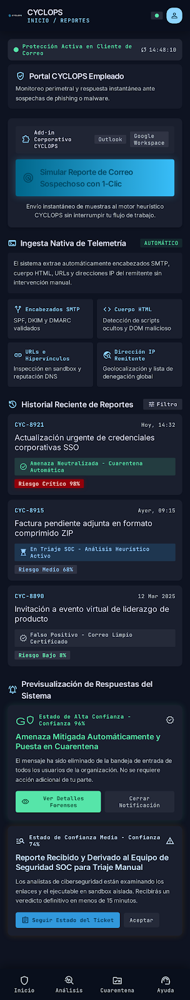
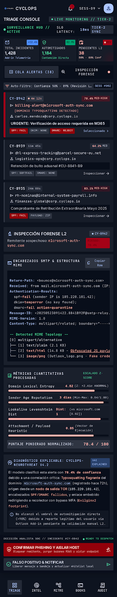

# CYCLOPS

Plataforma modular Enterprise para la detección proactiva de amenazas de ciberseguridad, análisis de correo malicioso y respuesta automatizada ante incidentes mediante Machine Learning.

---
<br>

## Descripción del Proyecto

**CYCLOPS** es una solución avanzada diseñada para resolver la problemática del fraude por ingeniería social, phishing y vectores de ataque transmitidos por correo electrónico. El sistema procesa correos electrónicos en tiempo real, aplicando técnicas de Procesamiento de Lenguaje Natural y análisis cualitativo y cuantitativo sobre metadatos estructurales para clasificar de manera precisa correos legítimos frente a amenazas cibernéticas.

El objetivo principal de **CYCLOPS** es reducir la carga operativa de los analistas en centros de operaciones de seguridad mediante la automatización de la ingesta, análisis y categorización de eventos, permitiendo una integración futura con orquestadores de respuesta SOAR y XDR.

---
<br>

## Integrantes del Proyecto
Cristian Díaz 

---
<br>

## Stack Tecnológico Principal

### Frontend y Presentación
* **Librería Principal:** React
* **Lenguaje de Programación:** TypeScript
* **Estilos y Componentes:** Tailwind CSS
* **Gestión de Estado Global:** Zustand

### Backend y Servicios API
* **Lenguaje de Programación:** Python
* **Framework Web:** FastAPI
* **Validación de Datos:** Pydantic
* **Procesamiento Asíncrono:** Background Tasks nativo de FastAPI

### Capa de Inteligencia Artificial y Machine Learning
* **Librería de Analítica:** Scikit-Learn
* **Acondicionamiento de Métricas:** RobustScaler para control de valores atípicos
* **Procesamiento de Lenguaje Natural:** Pipeline NLP para lematización y extracción de características

### Almacenamiento y Persistencia
* **Base de Datos Relacional:** PostgreSQL
* **Control de Migraciones y Consultas:** SQLAlchemy y Alembic

---
<br>

## Componentes del Sistema

* **Capa de Pipeline de Datos - data_pipeline:** Encargada de la ingesta, unificación de conjuntos de datos heterogéneos, limpieza, anonimización, lematización NLP y extracción de características cuantitativas.
* **Capa de Dominio - domain:** Define las reglas de negocio puras, modelos de entidad de ciberseguridad y esquemas de transferencia de datos bajo Clean Architecture.
* **Capa de Infraestructura - infrastructure:** Conectores a bases de datos relacionales, repositorios y cargadores de modelos de Machine Learning.
* **Módulo de Escalado de Datos:** Implementación de RobustScaler alineada a los principios de prevención de fuga de datos mediante la separación estricta Train y Test en proporción 80 a 20.
* **Artefactos Serializados - models:** Almacenamiento en disco de transformadores y clasificadores congelados en formato pkl para su consumo inmediato en tiempo de ejecución.

---
<br>

## Productos y Requisitos del Sistema

Toda la definición estratégica, funcional y técnica del producto **CYCLOPS** se encuentra centralizada en la documentación de requerimientos:

* **Product Requirements Document-PRD:** docs/prd.md
  * **Visión y Alcance:** Definición del modelo B2B y estrategia de mitigación.
  * **Casos de Uso:** Escenarios de interacción para Empleado, IA y Analista SOC.
  * **Requerimientos Funcionales:** Reglas de negocio, ingesta, preprocesamiento y triaje.
  * **Requerimientos No Funcionales:** Criterios de rendimiento, seguridad, disponibilidad y mantenibilidad.

---
<br>

## Diagramas y Documentación de Arquitectura

El proyecto cuenta con una serie de diagramas técnicos que documentan la estructura, la lógica de negocio y la persistencia de datos del sistema **CYCLOPS**. A continuación se detalla la función de cada gráfico y su ubicación exacta dentro del repositorio:

1. **Diagrama de Componentes**
   * **Propósito:** Muestra la organización modular del sistema, la separación entre la interfaz en React, la orquestación en FastAPI, el pipeline de Inteligencia Artificial y la base de datos PostgreSQL.
   * **Ubicación:** [Ver Documento de Arquitectura](mi-framework-ia/docs/architecture.md)

2. **Diagrama de Clases**
   * **Propósito:** Define la estructura de objetos, servicios y tipos de datos que componen la lógica de backend en Python, detallando los servicios de escalado, evaluación y gestión de incidentes.
   * **Ubicación:** [Ver Documento de Arquitectura](mi-framework-ia/docs/architecture.md)

3. **Diagrama Entidad-Relación**
   * **Propósito:** Ilustra el diseño relacional de las tablas en PostgreSQL, garantizando la trazabilidad entre usuarios, incidentes, metadatos extraídos, evaluaciones de la IA y acciones de mitigación.
   * **Ubicación:** [Ver Documento de Arquitectura](mi-framework-ia/docs/architecture.md)

4. **Diagrama de Historias de Usuario**
   * **Propósito:** Mapea el flujo condicional de interacción entre el Empleado, el Agente de Inteligencia Artificial y el Analista SOC, destacando el camino de automatización para alta confianza frente al triaje manual.
   * **Ubicación:** [Ver Documento de Historias de Usuario](mi-framework-ia/docs/user_stories.md)

---

### Guía de Navegación Rápida

Para consultar las explicaciones detalladas y los enlaces directos a cada recurso en PDF, ingresa a las siguientes rutas del proyecto:

* **Documentación Técnica General:** [Revisa el archivo](mi-framework-ia/docs/architecture.md).
* **Flujos y Requerimientos Funcionales:** [Revisa el archivo](mi-framework-ia/docs/user_stories.md).
* **Prompts de Contexto Estratégico:** [Revisa el archivo](mi-framework-ia/docs/prompts.md).
* **Archivos Gráficos en PDF:** [Explora la carpeta](mi-framework-ia/docs/assets/).

---
<br>

## Arquitectura de Interfaces y Prototipado 

La plataforma **CYCLOPS** implementa una separación de interfaces basada en roles operativos para optimizar la usabilidad y reducir la fricción en la gestión de amenazas. Los prototipos interactivos de alta fidelidad fueron diseñados en Stitch bajo lineamientos de diseño corporativo en tema oscuro.

---

### 1. Portal del Empleado — Centro de Transparencia e Ingesta Nativa 

Para evitar la fricción operativa que generan los formularios manuales de envío, CYCLOPS integra un complemento nativo Add-in para clientes de correo institucional. 



#### Componentes Clave:
* **Detonador de Ingesta Nativa de Telemetría:** Permite el envío instantáneo del correo sospechoso mediante un solo clic. El complemento extrae automáticamente los encabezados SMTP completos SPF, DKIM, DMARC, el cuerpo HTML, las URLs embebidas y la dirección IP del remitente sin intervención manual del usuario.
* **Historial Dinámico de Reportes:** Muestra el estado en tiempo real de las evaluaciones previas, clasificándolas por identificador de incidente, nivel de riesgo atribuido por el modelo de IA y el estado de la mitigación.
* **Previsualización de Respuestas del Sistema:** Ilustra las dos vías del modelo de decisión:
  * *Estado de Alta Confianza (≥ 90%):* Notificación verde de amenaza neutralizada y puesta en cuarentena automática sin requerir intervención del equipo de seguridad.
  * *Estado de Confianza Media (50% - 89%):* Notificación de derivación al equipo SOC para triaje y análisis forense L2.

---

### 2. Consola de Triaje y Respuesta para Analistas SOC Tier-2 Sync

Panel de control de alta densidad de información diseñado para que el analista de ciberseguridad realice la inspección, validación y mitigación de casos ambiguos o de riesgo intermedio.



#### Componentes Clave:
* **Barra de Telemetría Global:** Expone las métricas operativas del día, diferenciando el total de incidentes recibidos, los casos automitigados por la IA y los eventos pendientes en la cola de triaje manual.
* **Cola Priorizada de Alertas:** Clasifica los incidentes en el rango de confianza media (50% - 89%) resaltando fallas de autenticación de correo (SPF/DMARC) y detección de dominios typosquatting.
* **Inspector Forense L2:**
  * Visor técnico de la estructura MIME y encabezados SMTP crudos.
  * Tabla de métricas cuantitativas transformadas estadísticamente mediante `RobustScaler` entropía de dominio, reputación de remitente y distancia Levenshtein.
  * Módulo de explicabilidad del modelo de IA indicando los vectores de riesgo específicos identificados en el mensaje.
* **Acciones Inmediatas de Mitigación:** Botones directos para confirmar phishing y aislar el activo en la red, o declarar falso positivo y restaurar el mensaje en la bandeja del usuario.

---
<br>

## Generación del Prototipo MVP con Google Antigravity

Para la construcción de la interfaz gráfica interactiva del Producto Mínimo Viable -MVP-, se utilizó la herramienta Google Antigravity mediante un proceso de ingeniería de prompts guiado por la documentación arquitectónica del proyecto.

### Prompt Utilizado para la Generación

```text
Actúa como un Arquitecto de Software Principal, Especialista en UX/UI Enterprise y Desarrollador Full-Stack. Realiza una auditoría y análisis exhaustivo de toda la estructura de carpetas de este workspace, prestando especial atención al directorio "assets/".

Tu objetivo principal es interpretar la documentación arquitectónica existente -historias de usuario, matriz de requerimientos funcionales y no funcionales, diagramas de clases, diagramas de componentes, diagramas de casos de uso y modelo entidad-relación presentes en "assets/"- y construir autónomamente la interfaz gráfica interactiva del Producto Mínimo Viable -MVP- del sistema CYCLOPS SENTINEL.

Selecciona la tecnología web más rápida, ligera y fácil de desplegar -por ejemplo Python con Streamlit o Gradio, o una interfaz web interactiva autosuficiente- garantizando que sea 100 por ciento funcional y ejecutable mediante un único comando en terminal.

Fases de Ejecución Esperadas:

1. Auditoría y Lectura de Documentación Técnica en "assets/":
   - Analiza las historias de usuario y requerimientos funcionales para extraer los flujos de interacción clave del usuario y del analista de ciberseguridad.
   - Revisa el diagrama de clases y el modelo entidad-relación para asegurar que los componentes visuales de la interfaz reflejen fielmente las entidades y métricas del dominio de datos -char_count, url_count, has_url, urgency_score, url_density, urgency_density e is_threat-.
   - Examina el diagrama de componentes y casos de uso para estructurar los módulos principales del prototipo.

2. Módulos Obligatorios de la Interfaz del MVP:
   - Módulo de Inferencia en Tiempo Real: Área de texto interactiva para ingresar mensajes sospechosos, botones de prueba rápida para plantillas preconfiguradas -Phishing y Legítimo- y acción de análisis.
   - Panel de Extracción de Métricas: Despliegue en pantalla de los datos extraídos e indicadores sintéticos de densidad.
   - Panel de Diagnóstico Predictivo: Veredicto claro con nivel de riesgo y probabilidad calculada.
   - Panel de Explicabilidad y Reglas de Decisión: Sección denominada Parámetros de Evaluación y Reglas de Decisión que desglose la secuencia lógica de evaluación en niveles.
   - Vista de Arquitectura y Documentación: Pestaña o módulo interactivo donde se visualicen los diagramas de casos de uso, diagrama de clases y requerimientos extraídos de la carpeta "assets/".

Restricciones Estrictas de Formato, Estilo y Código:
- Aplicar un estilo visual elegante y moderno con una paleta de colores pasteles azules y blancos, bordes redondeados y tipografía clara.
- Queda estrictamente prohibido utilizar el signo de paréntesis en cualquier parte de la interfaz gráfica, etiquetas, textos explicativos, logs, encabezados o comentarios del código. Utiliza comas, guiones o puntos en su lugar.
- Mantén limpia la cabecera y el pie de página, mostrando únicamente el nombre oficial del sistema: CYCLOPS SENTINEL.
- Proporciona en la terminal las instrucciones exactas de ejecución al finalizar la generación de archivos.
